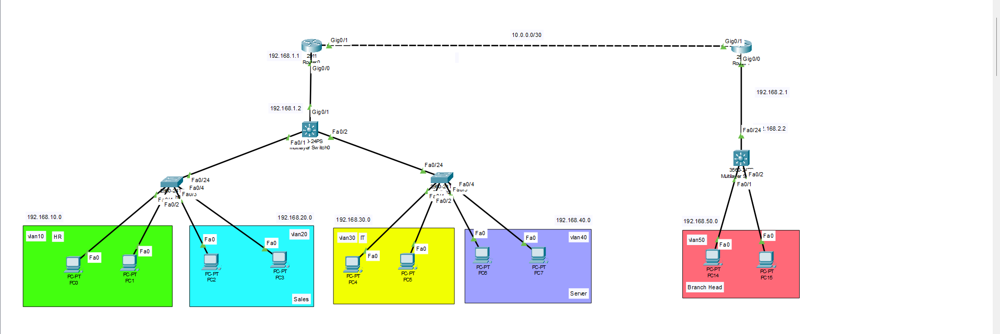

# Two-Site Enterprise Network (Cisco Packet Tracer)

A two-site network (HQ and Branch) designed and configured in Cisco Packet Tracer. It uses VLANs, inter-VLAN routing on a multilayer switch, DHCP, EIGRP dynamic routing, and a dedicated management VLAN.



## Project goals

- Segment an office network into departments using VLANs
- Divide address space with subnetting, including a /30 point-to-point WAN link
- Route traffic between VLANs and between two sites
- Assign addresses automatically with DHCP
- Replace static routes with EIGRP so the network learns routes dynamically
- Separate device management traffic from user traffic with a management VLAN

## Topology overview

| Site   | Devices                                              | VLANs              |
|--------|------------------------------------------------------|--------------------|
| HQ     | Router (hqRouter), core multilayer switch (SW1), access switches (SW2, SW3) | 10 HR, 20 Sales, 30 IT, 40 Servers, 99 Management |
| Branch | Router (branch), multilayer switch (SW4)             | 50 Branch          |

The two routers are connected by a 10.0.0.0/30 WAN link.

The full address plan is in [addressing-table.md](addressing-table.md).

## What was configured

**Subnetting**
- One /24 subnet per VLAN
- A /30 subnet for the WAN link, which leaves exactly two usable addresses for the two routers

**VLANs and switching**
- Access ports for end devices and trunk links between switches
- VLAN 99 as a management VLAN with separate IP addresses for the switches, kept apart from user traffic
- Inter-VLAN routing on the core multilayer switch using VLAN interfaces (SVIs)

**DHCP**
- R1 serves the HQ VLANs, and R2 serves the Branch VLAN
- The gateway and the first addresses of each subnet are excluded from the pools
- `ip helper-address` on the VLAN interfaces forwards DHCP requests from the HQ VLANs to R1

**Routing**
- EIGRP (AS 100) on the routers and multilayer switches, with `no auto-summary`
- Static routes were used first, then replaced with EIGRP

**Device hardening**
- Hostnames and an `enable secret` on every device
- Console access protected with a password

## Verification

| Test | Result |
|------|--------|
| VLANs and trunks on switches |  |
| DHCP address on a PC |  |
| EIGRP neighbors on R1 |  |
| Routing table showing EIGRP routes (`D`) |  |
| Cross-site ping (HQ to Branch) |  |
| Cross-site traceroute |  |

More screenshots are in the [screenshots](screenshots/) folder.

## Useful commands

```
show vlan brief
show interfaces trunk
show ip interface brief
show ip dhcp binding
show ip eigrp neighbors
show ip route
```

## Repository contents

```
README.md
addressing-table.md
topology.png
network-project.pkt
configs/        Running configs for each device
screenshots/    Verification output
```

## How to open the project

1. Install Cisco Packet Tracer.
2. Download `network-project.pkt` from this repository.
3. Open it in Packet Tracer and use the CLI on each device to run the commands above.

## Skills demonstrated

Subnetting, VLANs, trunking, inter-VLAN routing, DHCP, EIGRP, management VLAN design, basic device security, network documentation and troubleshooting.

## Possible future improvements

- Access control lists (ACLs) to restrict traffic between VLANs
- NAT/PAT for internet access
- OSPF as an alternative routing protocol
- SSH for secure remote management
- Port security on access ports
